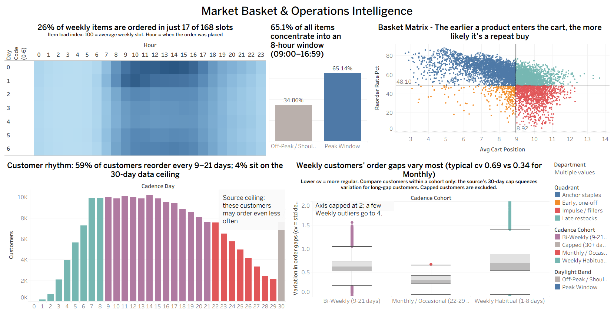
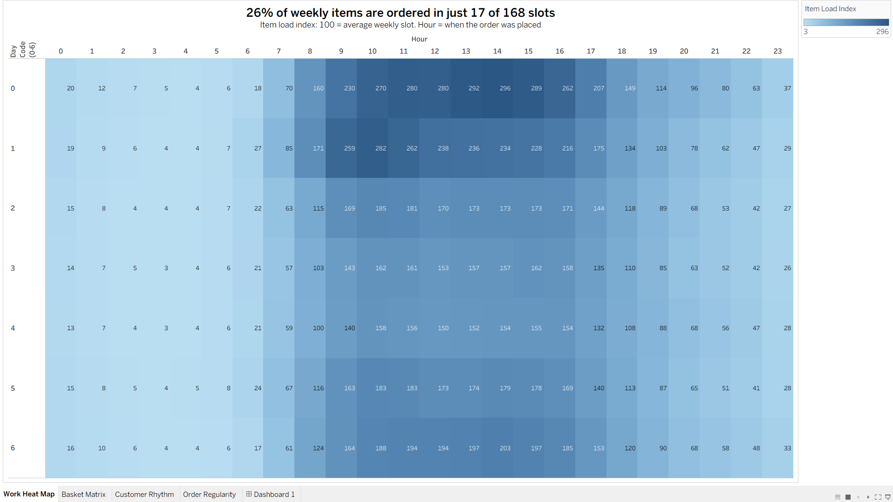
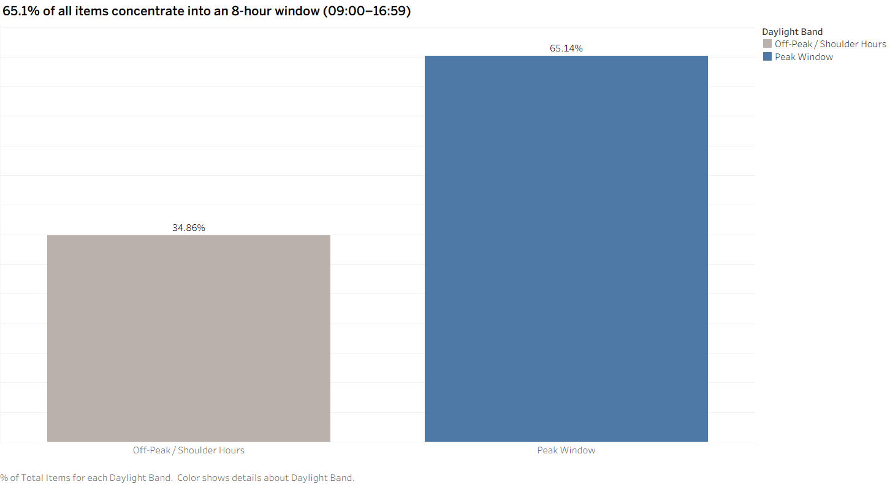
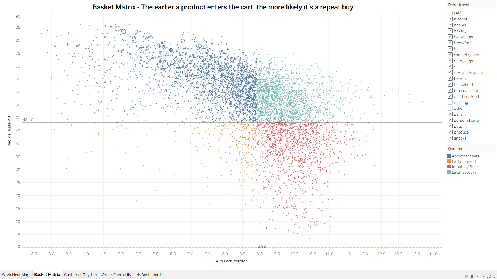
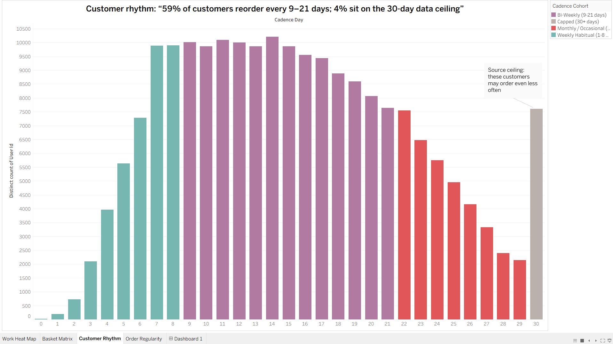
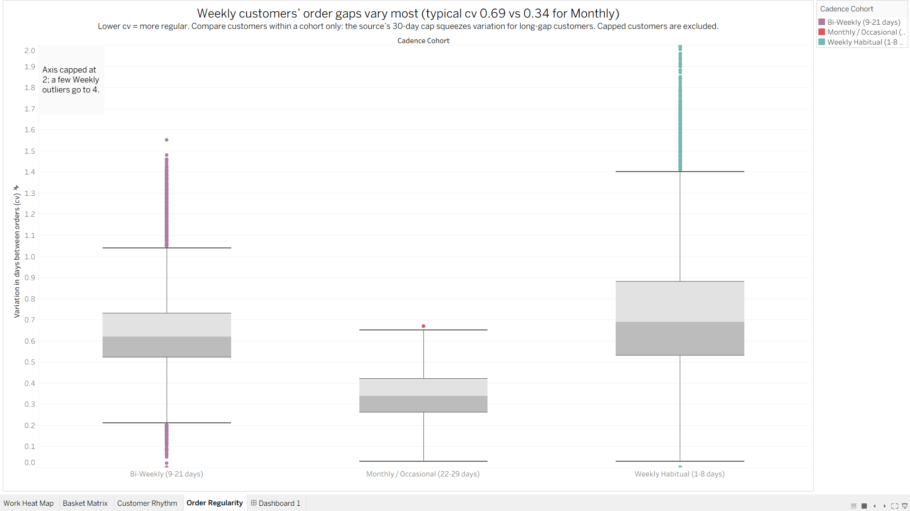

# Instacart Market Basket & Operations Intelligence

A PostgreSQL + Tableau project that turns the public Instacart order data (~3.4M orders) into an
operations-focused dashboard: **which products anchor a basket, how often customers come back, and when
fulfillment demand peaks.**



## Business questions

| # | Question | Operational use |
|---|----------|-----------------|
| 1 | Which products are added first and reordered most? | Slotting, stock priority, substitution rules for high-reorder staples |
| 2 | How often does each customer return, and how are customers distributed by cadence? | Demand forecasting, retention targeting by cohort |
| 3 | Which day/hour combinations carry the most orders? | Picker/driver scheduling, delivery-slot capacity |

## Dashboard

Five views built in Tableau, each from a summary table in the SQL layer (below). The workbook file is not included; the screenshots show the final result.

### Work Heat Map
Item load index for each day-code x hour slot, where 100 is the average of the 168 weekly slots (`mv_slot_workload`). Slots are weighted by items ordered, not order count, because picking effort scales with items. The hour is when the order was placed.



### Daypart Concentration
Share of all items ordered between 09:00 and 16:59 against all other hours, from the slot-level item counts (query 8.5 in `sql/08_workload_analysis.sql`).



### Basket Matrix
Every product with at least 100 purchases, plotted by average cart position (x) against reorder rate (y) (`mv_product_basket_dynamics`). Quadrants split at the all-product averages (8.92 and 48.1%): Anchor staples, Early one-off, Late restocks, Impulse / fillers. Dot size is purchase volume. The placeholder departments "missing" and "other" are hidden.



### Customer Rhythm
Customers by rounded average days between orders, colored by cadence cohort assigned in SQL (`mv_customer_lifecycle`). The bar at day 30 is the source's ceiling.



### Order Regularity
Box plot of the coefficient of variation of each customer's order gaps, by cohort (`mv_customer_segments`). Capped customers and customers with under 6 orders are excluded.



### Full dashboard


## Findings

Results from running `sql/07_insights.sql` and `sql/08_workload_analysis.sql` on the full dataset (206,209 customers).

| # | Finding | Evidence | Query |
|---|---------|----------|-------|
| 1 | Demand has a broad daytime plateau with a peak on top, not a spike. 17 of 168 slots (10%) carry 26% of all items ordered: hours 09-17 on day code 0 and hours 09-16 on day code 1. Across the whole week, 40 slots (24%) carry half of all items and 74 (44%) carry 80%. The busiest slot (day 0, 14:00) is 2.96x an average slot and 3.44x the median slot. | Item load index 296 at the peak; top 10 slots hold 16.5% of items | 8.1-8.3 |
| 2 | Ranking slots by items instead of orders changes the order. Day 1 at 10:00 has the most orders (54,719) but ranks 4th by items. Day 6 daytime slots climb 17-18 ranks when weighted by items (about 10.7-10.9 items per order), while day 2 afternoon slots fall 11-13 ranks (about 9.4-9.5 items per order). | Avg items per order 11.2 on day 0 vs 10.4 on day 1 in the peak slots | 8.1, 8.4 |
| 3 | Order size is right-skewed: median 8 items, mean 10.1, 90th percentile 20, 99th percentile 35; 2.4% of orders have 30 or more items. | | 7.4 |
| 4 | Two departments make up 46% of all items (produce 29.2%, dairy & eggs 16.7%); the top four (adding snacks and beverages) make up 63%. | Reorder rates: dairy & eggs 67%, beverages 65%, produce 65%, pantry only 35% | 7.2 |
| 5 | The catalog is highly concentrated: 790 products (1.6% of 49,685) account for half of all items, and 4,559 (9.2%) for 80%. | | 7.3 |
| 6 | The earlier a product enters the cart, the more likely it is a repeat purchase. Beverages and dairy are added earliest (average positions 7.0 and 7.5) and are reordered 65-67% of the time; pantry and canned goods come last (9.6 and 10.0) with 35% and 46%. | Basket matrix | 7.2 |
| 7 | Heavy, bulky staples are added to the cart first more often than anything else: mineral water (46.8% of its purchases), organic low-fat milk (40.3%, with an 83.8% reorder rate), drinking water (40.4%), paper towels (36.2%) and vodka (35.6%). | Products with at least 1,000 purchases | 7.1 |
| 8 | Customers cluster at 9-21 day cadence: 59% of customers (122,112) are Bi-Weekly, 19% Weekly (1-8 days), 18% Monthly (22-29 days) and 4% (7,604) sit on the source's 30-day ceiling. | Cadence chart | 06 |
| 9 | Long-gap customers are not more variable, they are compressed by the cap: median gap variation (cv) is 0.69 for Weekly, 0.62 for Bi-Weekly and 0.34 for Monthly. Regularity tiers are therefore relative within a cohort. | | 7.6b |
| 10 | Average gap shrinks from 15.5 days (order 2) to 7.8 days (order 30) and the reorder rate rises from 27% to 78%. This mixes real behavior change with survivorship (only heavy users reach order 30) and with the mechanical effect of a growing purchase history, so it is not evidence that an individual customer speeds up. | | 7.5 |
| 11 | Among the 200 highest-volume products, the strongest co-purchases are recipe-style sets in fresh produce, bought together 6 to 14 times more often than chance (lift): blackberries with raspberries (lift 14.2; 26% of blackberry orders also contain raspberries), cilantro with jalapenos and green onions (about 9.6, 9.6 and 8.8 across variants), organic milk with organic eggs (6.7 to 9.6 across product variants), canned diced tomatoes with black beans (7.7 and 6.4). Limes with bunched cilantro is the most frequent pair (13,049 orders, 0.39% of all orders) at lift 6.3. Soda with clementines (lift 9.4, 3,361 orders) is an unexplained cross-category pair. Cilantro appears in 7 of the 20 strongest pairs. The top 20 rows reduce to about six or seven distinct baskets because they repeat product variants. | Lift, pair counts and both confidence directions | 7.7 |
| 12 | Orders are placed overwhelmingly in core hours: 09:00-16:59 carries 65.1% of all items (22.0M of 33.8M), 17:00-20:59 carries 18.4%, 06:00-08:59 carries 8.9%, 21:00-23:59 carries 5.7% and 00:00-05:59 only 1.8%. | The same 3.35M orders are split across the five dayparts | 8.5 |
| 13 | Order size varies by daypart: orders placed 21:00-23:59 are the largest (10.9 items on average) and 17:00-20:59 the smallest (9.7); core hours average 10.1. | | 8.5 |

## Recommendations

| Recommendation | Supported by | Assumption / risk |
|----------------|--------------|-------------------|
| Staff in two layers: base coverage across the whole week in the 09:00-16:59 core (65% of items), plus surge capacity on day 0 (hours 09-17) and day 1 (hours 09-16). Keep 00:00-05:59 (1.8% of items) to a minimal crew. | 1, 12 | The data has no calendar dates, so loads are relative (100 = average slot) and cannot become headcount without a picks-per-hour figure. Day codes are unlabeled. The data records when an order was *placed*, so this treats demand arrival as a proxy for fulfillment workload. |
| Size staffing on items, not orders. | 2, 3 | Item count is a proxy for picking effort; store layout and item type also matter. |
| Give the roughly 800 to 4,600 highest-volume products priority for stock, pick-face position and substitution rules. | 5 | Long-tail products still matter to customer satisfaction; review them, do not delete them on volume alone. |
| Protect availability of high-reorder perishables and staples (produce, dairy, water, milk): a stock-out hits repeat buyers and starts baskets. | 4, 6, 7 | "Added first" is cart order, not pick order. |
| Treat the fresh-produce recipe sets (cilantro, jalapenos, limes, onions; berries; organic milk with eggs) as linked demand: cross-sell them together and set substitution rules so one stock-out does not break the set. | 11 | Co-purchase is observational. High lift partly reflects shopper type (for example organic or cooking-oriented shoppers buy many related items), and the analysis covers only the 200 top products. |
| Treat the first few orders of a new customer as a separate forecasting segment: only 27% of the second order is repeat items, against about 65% by the eleventh. | 10 | Partly a mechanical effect of having little purchase history. |
| Offer recurring delivery slots first to the "More regular" Weekly and Bi-Weekly customers (44,994, 22% of all customers). | 8, 9 | Tiers are relative terciles, so check absolute gap variation before promising a fixed slot. |

## Data caveats (read before quoting any number)

- **`days_since_prior_order` is capped at 30 in the source data.** The spike at day 30 is a ceiling effect, not a real "monthly habit". `04_data_quality.sql` reports how much of the data sits on the cap.
- **Day-of-week codes are undocumented.** The source does not say which day is 0. The day names shown in the workbook screenshots are an assumption, so treat the codes 0-6 as unlabeled.
- **No calendar dates exist**, so workload figures are *relative* (100 = the average of the 168 weekly slots). They cannot be converted into absolute headcount without outside assumptions.
- **Only established customers are included** (the per-user order count starts at about 4), so churn and retention cannot be measured here. The lifecycle view describes ordering cadence, not retention.
- **Cadence is a per-user average of gaps**, so it hides variance. `mv_customer_segments` adds a coefficient of variation (`cv`) and a *relative* regularity tier (More regular / Typical / Less regular = terciles of `cv` among customers in the same cohort). Tiers cannot be compared across cohorts: the source's 30-day cap compresses the spread for long-gap customers, so a fixed cut-off mostly sorts by cadence length. The Capped cohort is not measurable.
- **Product pairs are co-occurrence, not sequence.** `product_a` is just the lower product id of the pair, so read both confidence columns; lift is symmetric. Variants of one product (organic and regular cilantro) show up as separate pairs.
- Products with fewer than 100 purchases are excluded from the basket matrix; product-pair analysis covers only the 200 highest-volume products.
- The data is a historical 2017 sample release with no prices, margins or cancellations, so this is behavior analysis, not profitability analysis.

## Repository structure

```
.
├── README.md
├── LICENSE
├── run_all.sh                         # builds everything in the right order
├── sql/
│   ├── 01_schema.sql                  # raw tables + keys (re-runnable)
│   ├── 02_load.sql                    # load the Kaggle CSVs (psql)
│   ├── 02b_load_pgadmin.sql           # same load as plain SQL for pgAdmin / GUI tools
│   ├── 03_indexes.sql                 # indexes + ANALYZE
│   ├── 04_data_quality.sql            # PASS/FAIL integrity checks + profile; stops the build on a FAIL
│   ├── 05_analytics_layer.sql         # summary tables the dashboard reads
│   ├── 06_dashboard_queries.sql       # checks on the summary layer + heatmap source
│   ├── 07_insights.sql                # business-question queries
│   ├── 08_workload_analysis.sql       # staffing / capacity queries
│   └── 09_export_csv_extracts.sql          # CSV extracts of the summary tables
├── docs/data_dictionary.md            # every summary table and metric definition
├── images/                            # dashboard screenshots (overview + one per view)
└── data/README.md                     # how to get the raw data
```

## SQL layer

| Object | Built in | Grain | Purpose |
|--------|----------|-------|---------|
| `mv_product_basket_dynamics` | 05 | product (>= 100 purchases) | Cart position and reorder rate for the basket matrix |
| `v_customer_lifecycle`, `mv_customer_lifecycle` | 05 | customer | Order cadence, rounded `cadence_day` and cohort |
| `mv_customer_segments` | 05 | customer | Cadence cohort x regularity tier |
| `mv_product_pairs` | 05 | product pair (top 200 products) | Support, confidence and lift |
| `mv_slot_workload` | 05 | day x hour (168 rows) | Orders, items and load indexes per weekly slot |

The `mv_` prefix is historical: these are plain tables rebuilt by `05_analytics_layer.sql`, not PostgreSQL materialized views. The names are kept because the dashboard was built on them.

## Reproduce it

**Requirements:** PostgreSQL 14+ (psql 13+ for `02_load.sql`) and about 2 GB free disk. Tableau is only needed if you want to rebuild the dashboard.

```bash
createdb instacart_db
# Download the CSVs (see data/README.md), then:
DATA_DIR=/path/to/csv/folder ./run_all.sh
```

Useful switches: `SKIP_LOAD=1` rebuilds only the analytics layer, `EXPORT=1` also writes CSV extracts of the summary tables into `exports/`,
`DB=name` picks another database, and `DQ_GATE=0` keeps building even if a data-quality check fails. Standard `PGHOST`, `PGUSER` and `PGPORT` variables apply.
The load uses server-side `COPY`, which needs a superuser or the `pg_read_server_files` role. On a GUI client, use `sql/02b_load_pgadmin.sql` instead and run the other files in numeric order.

To rebuild the dashboard, connect Tableau (or any BI tool) to `instacart_db` and use one `mv_` table per view, as listed in the SQL layer table.

**Testing:** the scripts were run end to end on PostgreSQL 16 against a synthetic dataset with the same schema (including a failure-injection test of the data-quality gate). Runtime on the full 3.4M-order dataset has not been measured; `07_insights.sql` query 7.5 and `mv_product_pairs` are the heaviest steps.

## Data model

```
dim_departments ─┐
dim_aisles ──────┴─< dim_products >─< fact_order_products >─ fact_orders
```

`fact_order_products` merges the `prior` and `train` line-item files. `fact_orders` includes `test` orders,
which have no line items; lifecycle and workload metrics use `prior` and `train` only (except the order-count heatmap query in `06`, which counts all orders).

## Tech

PostgreSQL, SQL (CTEs, window functions, `FILTER` aggregates, percentiles, summary tables), Tableau

## Author

**Sayuj S**: operations analytics, process improvement, Lean Six Sigma Black Belt.

## Acknowledgements

Dataset: "The Instacart Online Grocery Shopping Dataset 2017", released by Instacart via Kaggle. Not affiliated with Instacart.
